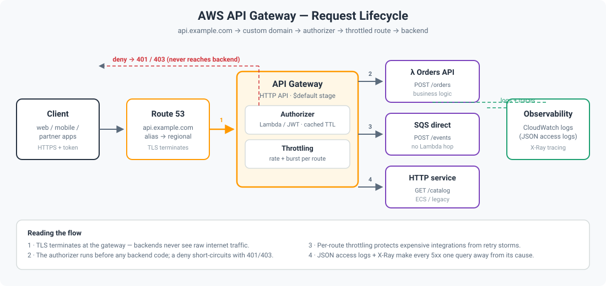

# AWS API Gateway Guide — The Front Door of Your API, Done Right


> **TL;DR:** API Gateway is the managed front door in front of your
> backends — it terminates TLS, authenticates callers, throttles abusive
> traffic, validates requests, and routes to Lambda, HTTP services, or AWS
> integrations. Pick **HTTP APIs** for 90% of workloads (cheap, fast),
> **REST APIs** when you need usage plans, API keys, or request/response
> transformation, and **WebSocket APIs** for bidirectional real-time
> channels. Put authentication in an authorizer, throttling in the stage,
> and observability everywhere.

## Why a managed gateway at all?

You *could* expose a Lambda Function URL or an ALB directly. You lose:

- **Central auth** — one authorizer for every route instead of auth code
  copy-pasted into each function.
- **Traffic protection** — throttling, quotas, and WAF at the edge instead
  of your Lambda bill absorbing a flood.
- **A stable contract** — request validation rejects malformed payloads
  *before* they reach your code; mapping and versioning keep clients
  decoupled from backend refactors.

**Rule of thumb:** if more than one client calls your backend, or anyone
pays per request, put a gateway in front of it.

## Which API type? (pick once, on purpose)

| | HTTP API | REST API | WebSocket API |
| --- | --- | --- | --- |
| Best for | Typical JSON APIs, microservices | Public developer platforms, partner APIs | Chat, live dashboards, gaming |
| Latency | Lowest (~no request transformation) | Higher (VTL mapping, full feature set) | Persistent connection |
| Auth | JWT (Cognito/OIDC), Lambda authorizer, IAM | Same + resource policies, API keys | Lambda authorizer, IAM, Cognito |
| Throttling | Per-route throttling | Per-method throttling, usage plans, quotas | Per-route |
| Caching | No built-in cache | Built-in response cache | N/A |
| Cost | ~$1.00 / million requests | ~$3.50 / million requests | ~$1.00 / million + connection minutes |
| Private endpoints | Private via VPC endpoint | Private + resource policies | No private option |

**Default choice: HTTP API.** Reach for REST API when you need usage
plans with API keys/quotas, request/response transformation, or a cache.
Reach for WebSocket only when the client genuinely needs server-push.

## Architecture



Traffic flow, step by step:

1. **Client → custom domain** — `api.example.com` via Route 53 alias to
   the API Gateway regional endpoint; TLS terminates here.
2. **Authorizer first** — every protected route runs a Lambda (or JWT)
   authorizer *before* the backend. Deny → `401/403` without touching
   your business logic. Cache authorizer results with a TTL to avoid
   paying per request.
3. **Route → integration** — routes like `POST /orders` map to Lambda,
   HTTP, or direct AWS-service integrations (e.g. SQS — no Lambda needed
   for pure ingestion).
4. **Throttling at the stage** — burst/rate limits absorb spikes; clients
   get `429` with `Retry-After` instead of your backend melting.
5. **Observability** — access logs (JSON, to CloudWatch) + X-Ray tracing
   so every `5xx` is one query away from its root cause.

## Core concepts (one minute each)

### Authorizers — auth happens once, at the door

A Lambda authorizer receives the request's token/headers and returns an
IAM policy: allow/deny per route. Use the **simple response format**
(`isAuthorized: true/false`) for HTTP APIs — it's cheaper and faster
than building full IAM policies. Set `authorizer_result_ttl_in_seconds`
so repeated calls from the same client skip re-authentication.

```jsonc
// What your Lambda authorizer returns (simple response, HTTP API)
{
  "isAuthorized": true,
  "context": { "userId": "u-123", "tier": "pro" }  // passed to your backend
}
```

### Throttling vs quotas — two different seatbelts

- **Throttling (rate + burst):** protects *your backend* from spikes.
  A steady 100 rps with a burst of 200 is a sane default; tune from
  CloudWatch `4XX`/`5XX` and `IntegrationLatency`.
- **Quotas (usage plans, REST API only):** protect *your business model*.
  "10,000 requests/month on the free tier" is enforced with API keys,
  not with code.

### Validation — reject garbage at the edge

Define JSON Schema models on routes (REST API) so malformed payloads
get a `400` with a useful message before any Lambda runs. Cheaper than
validating in code, and clients get consistent errors.

### Canary deploys — ship the gateway like code

API Gateway stages support canary releases: route 10% of traffic to the
new deployment, watch `5XXError` and latency in CloudWatch, then promote
or roll back. Your gateway config *is* infrastructure — keep it in
Terraform and deploy through CI, not the console.

## Minimal Terraform (HTTP API + Lambda + authorizer)

`main.tf` in this repo builds the whole picture: an HTTP API, a Lambda
integration behind `POST /orders`, a Lambda authorizer protecting it,
a `$default` stage with throttling and access logging, and the IAM to
wire it together. Apply, then test:

```bash
terraform init && terraform apply
curl -X POST https://<api-id>.execute-api.<region>.amazonaws.com/orders \
  -H "Authorization: Bearer <token>" -d '{"item":"book"}'
```

Without the header you should get `401`; with a valid token, `200`.
That 30-second check proves the authorizer, route, and integration all
work.

## Cost levers

- **HTTP API over REST API** saves ~70% per million requests when you
  don't need usage plans or caching.
- **Authorizer TTL** cuts authorizer Lambda invocations to near zero for
  repeat callers.
- **Direct AWS integrations** (API Gateway → SQS/DynamoDB) skip a Lambda
  hop entirely for ingestion workloads.
- **Log sampling:** full access logs are gold in week one; after that,
  log errors verbosely and sample successes to keep CloudWatch costs
  sane.

## Pitfalls (learned the hard way)

1. **Default throttling is generous — until it isn't.** The account-level
   default (10,000 rps) sounds high, but one viral endpoint plus retries
   can still cascade. Set explicit per-route limits on expensive routes.
2. **Caching authorizer results with user context.** A long TTL on an
   authorizer that returns per-user context is fine; a long TTL on a
   *deny* can lock a legitimate user out for minutes. Keep deny TTLs
   short.
3. **Binary payloads need explicit config.** Uploading images/files?
   Declare binary media types or API Gateway will base64-mangle your
   payloads.
4. **Timeout mismatch.** API Gateway caps integration timeout at 29s
   (REST) / 30s (HTTP). If your Lambda runs longer, the client gets a
   `504` while the function keeps running — and billing.
5. **Deploying from the console.** Console edits to a stage bypass your
   IaC and drift silently. Change the Terraform, run the pipeline.

## Quiz teaser

Think you got it? Five questions in [`quiz.md`](quiz.md) — HTTP vs REST
vs WebSocket, authorizer caching, throttling vs quotas, canary deploys,
and the 29-second trap. Answers hidden, no peeking. 👀
